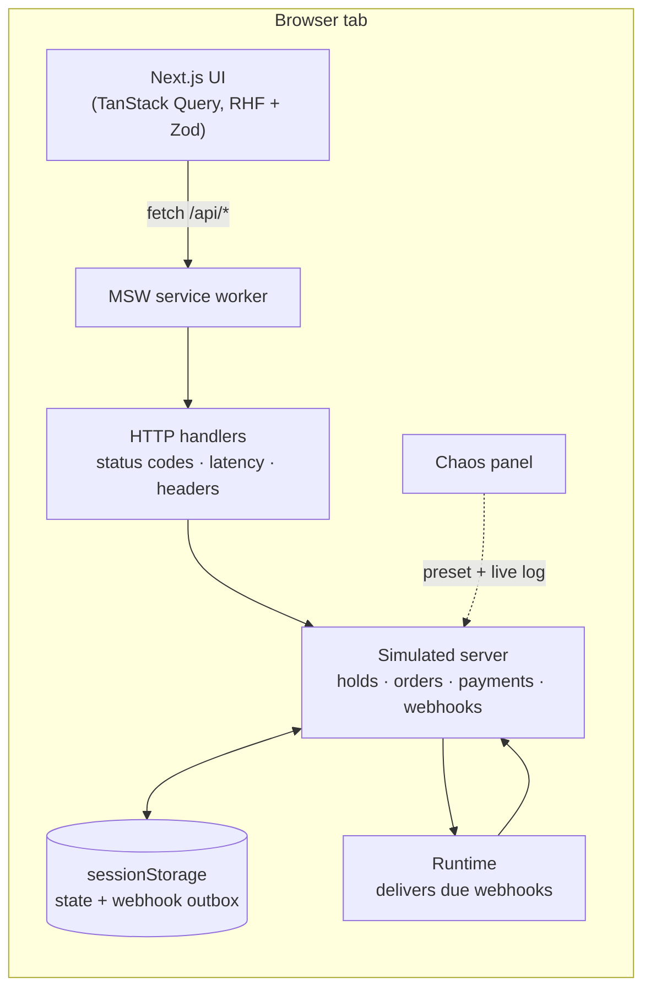
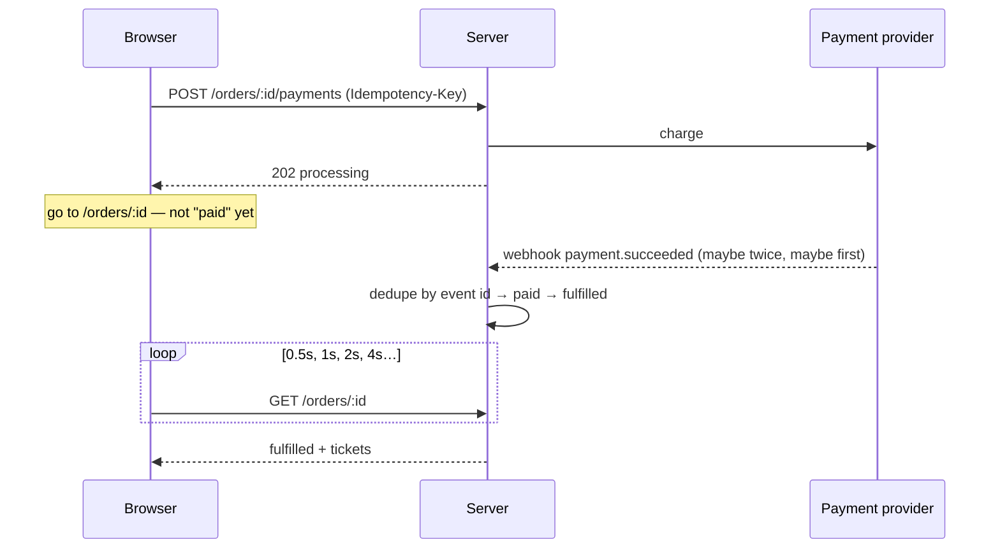

# admit-one

**An event-ticketing checkout, done properly — with a chaos panel to break it on purpose.**

Timed ticket holds that can't oversell, a typed step registry driven by the URL,
idempotent payments, deduplicated webhooks, and an order page that waits for the
truth instead of trusting a redirect. Pick a failure from the chaos panel — a declined
card, a webhook that arrives twice, a hold that expires mid-payment, a crowd buying the
last ticket — and watch the checkout handle it while the server log explains why.

**[Live demo](#)** · No sign-up, no keys, no real payments. The backend runs in your
browser, so your sandbox is yours alone.


## Try it

Open the **Chaos** panel (top right), pick a scenario, then buy a ticket. Each scenario
is also an end-to-end test that checks both what you see and what the server recorded.

| Scenario | What happens | What a correct checkout does |
|---|---|---|
| Happy path | Realistic latency | Confirming… for a moment, then tickets |
| Declined card | The bank says no | Inline error, details kept, retry with another card |
| 3-D Secure | The bank wants authentication | A challenge dialog; it survives a page refresh |
| Slow network | Every request takes ~3 s | Loading states; a double-click reserves once and pays once |
| Webhook arrives twice | At-least-once delivery | One set of tickets; the duplicate is logged and ignored |
| Webhook before redirect | The provider beats your browser | The order page opens already confirmed |
| Webhook delayed | 12 s before confirmation | Polling that backs off, then a reassuring note |
| Hold expires mid-payment | Payment lands after the hold is gone | A full refund, explained in plain words |
| Crowd buys the last ticket | Someone else gets there first | "Just missed it", live availability, never oversold |

Test cards work too: `4242…` succeeds, `4000 0000 0000 0002` is declined,
`4000 0025 0000 3155` asks for 3-D Secure.

## The hard parts

### 1. Holds that can't oversell — and expire without a timer

Choosing tickets creates a hold with an `expiresAt`. Availability is
`capacity − sold − tickets in live holds`, where *live* means `now < expiresAt`.
Expiry is **lazy**: an expired hold simply stops counting. There's no sweeper job, so
there's no window where a dead hold still blocks a buyer, and reads never write.
([decision](docs/decisions/002-holds-and-lazy-expiry.md))

### 2. A typed step registry, driven by the URL

Each step declares `isApplicable(ctx)` and `isComplete(ctx)`; the flow is whatever
applies (no extras step for events without extras). The URL —
`/checkout/[holdId]/[step]` — is the source of truth, so refresh resumes, deep links
can't skip ahead, and back/forward just work. Drafts persist per hold, and review only
counts as done if the server's order matches what you typed.
([decision](docs/decisions/003-step-registry.md))

### 3. The webhook, not the redirect, decides

Paying returns `202 processing` — never "paid". The browser goes to the order page,
which polls with backoff until the provider's webhook settles the order. Payments carry
an `Idempotency-Key` minted per *attempt* (a retry after a network error reuses it, so
it can never charge twice); webhooks are deduplicated by event id.
([decision](docs/decisions/004-payments-and-webhooks.md))

### 4. Payment after the hold expired

Starting a payment extends the hold once, and a payment in flight protects its order.
If the money still arrives after the tickets are gone, the order is refunded in full and
the page says why — rather than overselling or quietly keeping the money.

## How it works



The app's code is written exactly as it would be against a real API: plain `fetch`, real
status codes, real headers. The server (`src/server/`) is plain TypeScript with an
injectable clock, so every rule is unit-tested without a browser.



### Why the backend runs in the browser

So anyone can run the demo with zero setup, every visitor gets an isolated sandbox, and
the chaos panel can genuinely control the server. MSW runs handlers in the page, so the
server's state — including webhooks still waiting to be delivered — is persisted to
sessionStorage and resumes after a reload: the outbox pattern.

**What this doesn't exercise:** true multi-client concurrency. In a real database the
availability check and the hold insert would be one transaction or a conditional
`UPDATE … WHERE available >= qty`; here the server is single-threaded, so it's atomic by
construction. Contention is simulated by a crowd of bot buyers. Swapping in a real
backend means replacing `src/mocks/`, not the app.
([decision](docs/decisions/001-simulated-backend.md))

## Quality

| Check | Coverage |
|---|---|
| `npm test` | 67 unit, component and HTTP-contract tests: inventory, the order state machine (every legal and illegal transition), idempotency, webhook dedupe, persistence across reloads, the step registry, countdown maths, form validation |
| `npm run test:e2e` | 22 browser tests: one per chaos preset, plus refresh-resume (mid-form and mid-payment), step guards, expiry and re-reserve, threshold announcements, focus management, axe (WCAG 2.2 AA) in light and dark, 375 px, reduced motion |
| `npm run lhci` | Lighthouse ≥ 95 everywhere — currently 100 / 100 / 100 / 100 |

Accessibility details worth knowing: focus moves to each step's heading; the countdown
is announced at 2 min, 1 min and 30 s rather than every second; errors are linked to
their fields and the first one gets focus; the chaos panel and 3-D Secure challenge are
native `<dialog>`s.

Money is integer cents throughout, priced by one shared function (`priceOrder`) on both
the client and the server, so the total you see is the total that's charged.

## Running it

```bash
npm install
npm run dev          # http://localhost:3000
npm test             # unit, component and HTTP tests
npm run build && npm run test:e2e
```

No environment variables, keys or accounts needed.

## Layout

```
src/
  shared/        catalogue, API types, money, Zod schemas — used by client and server
  server/        the simulated backend: holds, orders, payments, webhooks, chaos presets
  mocks/         MSW handlers, the per-tab sandbox, persistence and the webhook runtime
  checkout/      step registry, drafts, countdown, the checkout flow and its steps
  components/    tier picker, order status, chaos panel, UI primitives
  app/           routes: /, /events/[slug], /checkout/[holdId]/[step], /orders/[orderId]
docs/decisions/  why things are the way they are
e2e/             Playwright: chaos presets and flows
```

## Not in v0.1

Accounts, assigned seating, emails, an organiser dashboard, and a real payment provider.
Next up is a Razorpay test-mode adapter behind the same provider interface.

---

Built by [Kshitiz Sonakiya](https://github.com/Punisher666). All events, venues and
people are fictional.
