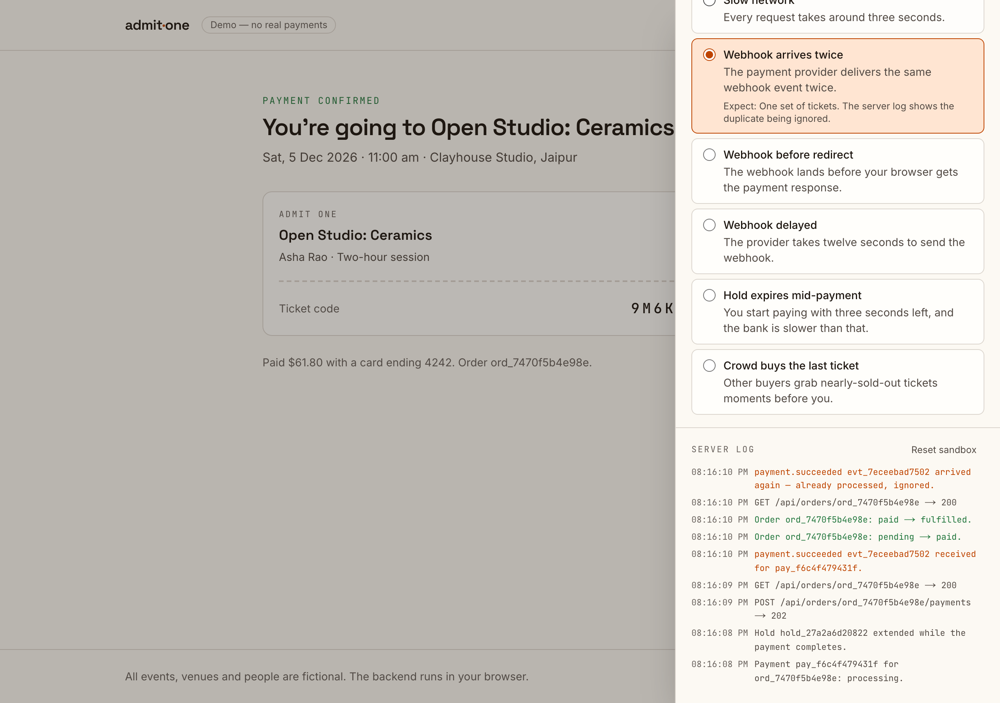
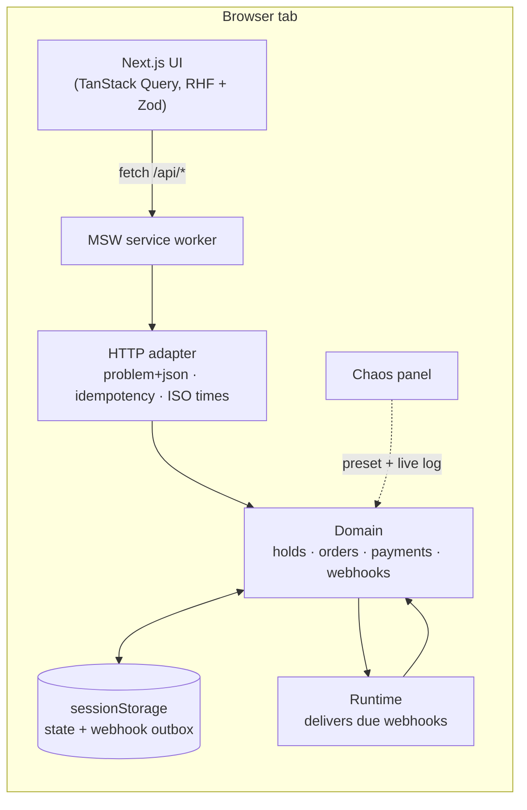
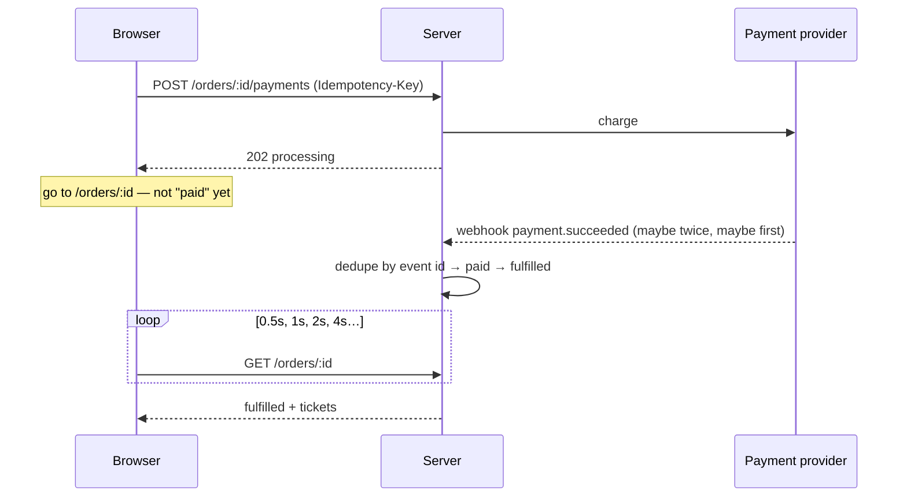

# admit-one

**An event-ticketing checkout, done properly — with a chaos panel to break it on purpose.**

Timed ticket holds that can't oversell, a seat map you can use with a keyboard, prices
that are all in from the first screen, card or UPI, a typed step registry driven by the
URL, idempotent payments, deduplicated webhooks, and an order page that waits for the
truth instead of trusting a redirect. Organisers get their own dashboard: live sales, a
9,000-order table that stays fast and accessible, and refunds. Tickets open in airplane
mode, and a door scanner checks them with no connection at all. Pick a failure from the chaos panel — a declined
card, a webhook that arrives twice, a hold that expires mid-payment, a crowd buying the
last ticket — and watch the checkout handle it while the server log explains why.

**[Live demo](https://admit-one-ten.vercel.app)** · No sign-up, no keys, no real payments. The backend runs in your
browser, so your sandbox is yours alone. The same checkout in server mode, on Postgres:
**[admit-one-server](https://admit-one-server.vercel.app)**.



## Try it

Open the **Chaos** panel (top right), pick a scenario, then buy a ticket. Each scenario
is also an end-to-end test that checks both what you see and what the server recorded.

| Scenario                   | What happens                                           | What a correct checkout does                                                     |
| -------------------------- | ------------------------------------------------------ | -------------------------------------------------------------------------------- |
| Happy path                 | Realistic latency                                      | Confirming… for a moment, then tickets                                           |
| Declined card              | The bank says no                                       | Inline error, details kept, retry with another card                              |
| 3-D Secure                 | The bank wants authentication                          | A challenge dialog; it survives a page refresh                                   |
| Slow network               | Every request takes ~3 s                               | Loading states; a double-click reserves once and pays once                       |
| Connection drops           | The payment's answer is lost; then a few status checks | Paying again replays the first answer — one charge; the page keeps what it knows |
| Webhook arrives twice      | At-least-once delivery                                 | One set of tickets; the duplicate is logged and ignored                          |
| Webhook before redirect    | The provider beats your browser                        | The order page opens already confirmed                                           |
| Webhook delayed            | 12 s before confirmation                               | Polling that backs off, then a reassuring note                                   |
| Hold expires mid-payment   | Payment lands after the hold is gone                   | A full refund, explained in plain words                                          |
| Crowd buys the last ticket | Someone else gets there first                          | "Just missed it", live availability, never oversold                              |
| Seat snatched              | Someone takes one of your chosen seats first           | Nothing held; the lost seat is named and the rest stay chosen                    |
| Too many attempts          | Reserving limited to 3 tries every 15 s                | A 429 with Retry-After; Reserve counts down, then works                          |
| Flash sale                 | 40,000 people (simulated) arrive at once               | A waiting room: your place, an honest wait, your turn announced                  |
| UPI declined               | You approve on your phone; your bank says no           | The webhook says so; a focused notice, nothing taken, pay by card instead        |
| UPI request expires        | A 15-second request nobody approves                    | The request runs out, the page says so, and a new one can be asked for           |
| Busy on-sale               | Other buyers take a ticket every 1.5 s                 | The organisers' dashboard updates live, and the orders table doesn't jump        |
| Refunds fail               | The provider refuses to start a refund                 | "Refund pending" rolls back, and a focused alert says why                        |

Test cards work too: `4242…` succeeds, `4000 0000 0000 0002` is declined,
`4000 0025 0000 3155` asks for 3-D Secure. Or pay by UPI, and approve or decline on the
simulated phone that appears below the checkout.

## The hard parts

### 1. Holds that can't oversell — and expire without a timer

Choosing tickets creates a hold with an `expiresAt`. Availability is
`capacity − sold − tickets in live holds`, where _live_ means `now < expiresAt`.
Expiry is **lazy**: an expired hold simply stops counting. There's no sweeper job, so
there's no window where a dead hold still blocks a buyer, and reads never write.
([decision](docs/decisions/002-holds-and-lazy-expiry.md))

### 2. A typed step registry, driven by the URL

Each step declares `isApplicable(ctx)` and `isComplete(ctx)`; the flow is whatever
applies (no extras step for events without extras). The URL —
`/checkout/[holdId]/[step]` — is the source of truth, so refresh resumes, deep links
can't skip ahead, and back/forward just work. Drafts persist per hold, and review only
counts as done if the server's order matches what you typed.
([decision](docs/decisions/003-step-registry.md))

### 3. The webhook, not the redirect, decides

Paying returns `202 processing` — never "paid". The browser goes to the order page,
which polls with backoff until the provider's webhook settles the order. Payments carry
an `Idempotency-Key` minted per _attempt_ (a retry after a network error reuses it, so
it can never charge twice — the "Connection drops" scenario shows it); webhooks are
deduplicated by event id. A status check that fails keeps the last known state on
screen rather than replacing it with an error.
([decision](docs/decisions/004-payments-and-webhooks.md))

### 4. Payment after the hold expired

Starting a payment extends the hold once, and a payment in flight protects its order.
If the money still arrives after the tickets are gone, the order is refunded in full and
the page says why — rather than overselling or quietly keeping the money.

### 5. A seat map you can use with a keyboard

The concert at Rangmanch Auditorium has reserved seating: 998 seats, drawn from static
data and server-rendered. Each section is a WAI-ARIA grid with one tab stop. The arrow
keys step over aisles, and Up and Down go to the seat _in front_, not the one with the
same number. Every seat says its row, number, tier, price and state. Choosing seats is
all-or-nothing: if one has gone, nothing is held and the server names it. "Best
available" lets the server choose and hold in one step, keeping a party together
without stranding a single seat. An e2e budget keeps the longest interaction under
200 ms with the CPU slowed four times.
([decision](docs/decisions/010-reserved-seating.md))

### 6. A waiting room, and a limit on trying

In a flash sale, everyone queues first. The line is first in, first out, a batch at a
time, and your place is computed from when you joined and the clock: nothing ticks, a
refresh keeps it, and the server says when to check again. The page shows the people
ahead, a bar that only moves forward and a coarse wait. When your turn comes, it says
so and moves focus, but doesn't redirect you. Reserving is also rate-limited: the
fourth try in 15 seconds is a 429 with `Retry-After`, and the page waits exactly that
long. ([decision](docs/decisions/011-waiting-room-and-rate-limits.md))

### 7. The price you see is the price you pay

Showing a base price and adding fees at checkout is drip pricing, which India's dark
patterns guidelines and the US FTC's fees rule both ban. So every price on screen is all
in: the 3% booking fee and GST included, with what it's made of one line away. One
pricing engine serves the server's charge and every label. GST rules are data: 18% on
admission, none at ₹500 or less, and 18% on the fee. Tax is worked out per ticket in
paise, as CGST and SGST halves each rounded, so one ticket's price times the quantity
is exactly the total. ([decision](docs/decisions/012-gst-and-all-in-pricing.md))

### 8. UPI: approved in another app, settled by webhook

Merchants can't send "collect" requests any more (NPCI, 2026), so a UPI payment is an
intent. That's a `upi://pay` link, with the merchant category code and a reference
unique to the payment, shown as a QR code on a computer or opened as the UPI app on a
phone. The buyer answers in another app, so the page never learns the outcome from the
browser: it re-reads the order, and the webhook decides. A request runs out after five
minutes (lazily, like a hold), never outlasts the hold, and can be cancelled to pay by
card. ([decision](docs/decisions/013-upi-by-intent-and-qr.md))

### 9. An organisers' dashboard, with access checked twice

Sign in as one of three demo accounts across two organisations. Each sees only its own
events' orders and only what its role allows. The same `can()` rule hides the Refund
button from the box office and makes the server refuse it anyway. Statuses are exact:
401 for no session, 403 for an event that isn't yours, and 404 for an order that
isn't, so its existence isn't confirmed. ([decision](docs/decisions/014-organiser-access.md))

### 10. Nine thousand orders in a table that stays a table

The history is generated from a seed, not stored, and it agrees with the catalogue to
the ticket. The server filters, sorts (AIP-132) and pages by keyset (AIP-158), so new
orders between pages can't repeat or skip a row.

- **The table:** TanStack Virtual draws about 30 rows, but it's still a real
  `<table>`, with spacer rows instead of absolute positioning. `aria-rowcount` and
  `aria-rowindex` tell screen readers the whole story, and a focused row stays drawn.
- **The filters:** they live in the URL, and they're optimistic, so they respond at
  once.
- **Live updates:** server-sent events read with `fetch` (so they can carry a token)
  refresh what's on screen, and can be paused. The table offers new rows rather than
  moving under you.

([decision](docs/decisions/015-reporting-at-scale.md))

### 11. Refunds, optimistic and honest

A refund is an idempotent request settled by webhook, like a payment. The dashboard
shows "Refund pending" at once, on the order and in every cached table page. If the
provider refuses, everything rolls back and a focused alert says why. Refunded tickets
go back on sale, and door scanners refuse the old ones once they've fetched the event's
list of refunded codes, which they keep for offline. ([decision](docs/decisions/016-refunds.md))

### 12. Every state in a catalogue, every pixel checked

The checkout and the order page render a state; their view-model hooks supply it. So
every state is a story in a Storybook catalogue, built from data the contract's schemas
parse, including ones that are hard to reach by clicking. Components that fetch their
own data run on a fresh copy of the sandbox for every story.

- **Every story is a test:** it renders in Chromium, passes its play function, and has
  no axe violations.
- **Every story is a screenshot,** in light and dark, and at 375 px for whole screens,
  made in Playwright's Linux image on arm64, both on a laptop and in CI. Screenshots
  only compare on the machine that made them, and emulating Intel on Apple Silicon
  renders OKLCH colours as white.
- **It found two bugs at once:** an unlayered `:focus-visible` rule beat every
  `outline-none`; and a busy button, being `disabled`, could drop keyboard focus (a
  flaky screenshot, found by running the suite three times over).

([decision](docs/decisions/017-catalogue-and-visual-tests.md))

### 13. The same API on Postgres, and races the database can't lose

Built with `NEXT_PUBLIC_BACKEND=server`, the app talks to a server instead of the
sandbox: Next route handlers answer `/api/*` with the very handlers the sandbox runs in
its service worker, over Postgres. The same 14 HTTP contract tests pass on both
backends, and so do 24 end-to-end flows.

- **Stock and seats:** a hold takes tickets with one conditional update of the tier's
  row, and seats with a partial unique index. Against real Postgres, 50 buyers at the
  last 10 tickets get exactly 10, and 20 buyers for one pair of seats get one.
- **Everything else:** the sandbox's own rules, run on the server's rows under a lock on
  the hold. Ten payments at once for one order give one charge.
- **Webhooks:** signed by a simulated provider, checked over the raw body, and acted on
  once, in the same transaction as their effect. Each is delivered under a lease, and
  one that fails is retried with backoff rather than holding up the rest. A payment
  confirmed while its hold was live keeps its tickets, however late its webhook.
- **Production means production:** without its database, webhook secret, ticket key
  and fingerprint secret, the server refuses to start, and says which are missing.
- **A race test that couldn't fail:** on a cold connection pool, the first
  "simultaneous" request finished before the rest connected. Each test pool now opens
  every connection first, and a version without the lock fails.

([decision](docs/decisions/018-server-mode.md))

### 14. Tickets that work in a basement

Doors are where networks fail, so neither the ticket nor the check needs one.

- **A ticket is a signed token.** Each one carries its claims and an Ed25519 signature,
  in its QR code. The door checks it with the public key alone, so a ticket that was
  changed, or made up, is refused offline.
- **The wallet is on the device.** Tickets are saved to IndexedDB when they're issued,
  and `/tickets` opens with no network, after a reload or in a new tab.
- **One service worker, two jobs.** A scope has one worker, and MSW's already had the
  site's, so the app's worker imports MSW's. Its own listeners go first. MSW's worker
  also unregisters itself when its last tab closes, so the merged one keeps its
  registration, or the wallet would find no worker the next time.
- **The door scanner** (`/scan`) uses the browser's `BarcodeDetector` where there is
  one, and ZXing in WebAssembly elsewhere, served from this site. It remembers whom it
  has let in, in one IndexedDB transaction per scan. Only this page may use the camera
  or compile WebAssembly, so it's always reached by a full page load: headers are per
  document.
- **Refunds reach the door:** a signature can't say a ticket was refunded, so the door
  fetches its event's refunded codes while online, keeps them, and says when it last
  checked.
- **Tested with a fake camera:** Chromium plays a video of a signed ticket, and the
  scanner reads it. Then the same ticket, after a reload, reads as already scanned.

([decision](docs/decisions/019-offline-tickets-and-door-scanner.md))

## How it works



The app's code is written exactly as it would be against a real API: plain `fetch`, real
status codes, real headers, and every response parsed against the contract's schemas.
The backend (`src/backend/`) is plain TypeScript with an injectable clock, so every rule
is unit-tested without a browser. The layers, and the lint rules that enforce them, are
in [docs/architecture.md](docs/architecture.md).



### Why the backend runs in the browser

So anyone can run the demo with zero setup, every visitor gets an isolated sandbox, and
the chaos panel can genuinely control the server. MSW runs handlers in the page, so the
server's state — including webhooks still waiting to be delivered — is persisted to
sessionStorage and resumes after a reload: the outbox pattern.

**What the sandbox doesn't exercise:** true multi-client concurrency. In the browser the
backend is single-threaded, so a hold is atomic by construction, and contention is
simulated by a crowd of bot buyers. Server mode exercises the real thing: the same API
on Postgres, where the database itself refuses an oversold tier or a seat held twice
(see 13 above). The default build never loads it.
([decision](docs/decisions/001-simulated-backend.md))

## Quality

| Check                        | Coverage                                                                                                                                                                                                                                                                                                                                                                                                                                                                                                                                                                                                                                                                                                                                                                                                                                                                                                                                                                                                                                                                                                                                                                                                                                                         |
| ---------------------------- | ---------------------------------------------------------------------------------------------------------------------------------------------------------------------------------------------------------------------------------------------------------------------------------------------------------------------------------------------------------------------------------------------------------------------------------------------------------------------------------------------------------------------------------------------------------------------------------------------------------------------------------------------------------------------------------------------------------------------------------------------------------------------------------------------------------------------------------------------------------------------------------------------------------------------------------------------------------------------------------------------------------------------------------------------------------------------------------------------------------------------------------------------------------------------------------------------------------------------------------------------------------------- |
| `npm run lint` + `typecheck` | strict TypeScript (`noUncheckedIndexedAccess`, `exactOptionalPropertyTypes`, …) and type-aware ESLint: naming conventions, exhaustive switches, and the layer boundaries                                                                                                                                                                                                                                                                                                                                                                                                                                                                                                                                                                                                                                                                                                                                                                                                                                                                                                                                                                                                                                                                                         |
| `npm test`                   | 533 unit, component and HTTP-contract tests: signed tickets (tampered, forged, unknown keys), the door's decisions (refunded tickets too), its scan log (two scans at once) and its camera (released when the page goes, paused while hidden), whom the door's keyring trusts, the service worker's URL per build, the wallet, the catalogue's fixtures against the contract, permissions and tenant isolation, keyset paging, CSV escaping and its download, metrics in the organiser's time zone, refunds and their keys, the live stream (a catch-up, a garbled event), the virtualised table's ARIA and focus under filtering and sorting, the search box's debounce, optimistic rollback, pricing and GST, UPI intents, expiry and cancelling, inventory, the order state machine (every legal and illegal transition), idempotency and its fingerprint, webhook dedupe, persistence, problem details, the server's settings per environment, the API client's errors and time-outs, the view-model state machines, the step registry, countdown maths, money and validation, the hall's geometry, the seat allocator (never stranding a seat), the seat map's keyboard model and its focus, the live regions, the waiting room's line and the rate limiter |
| `npm run test:server`        | 67 tests of the server backend against real Postgres: concurrent holds and seats, ten payments at once, Idempotency-Keys across processes and who owns a claim, signed webhooks (forged, altered, replayed, duplicated, rotated), a delivery that fails and is retried, a payment confirmed in time but delivered late, deadlocks retried, the rate limit per client (the sandbox's answers, a burst held to the limit), limits on input and bodies streamed past them, logs without buyers' data, the seed and the status constraints, and the shared HTTP contract                                                                                                                                                                                                                                                                                                                                                                                                                                                                                                                                                                                                                                                                                             |
| `npm run test:coverage`      | the same, with coverage floors per layer: core, contract, the backend domain and HTTP adapter, the checkout, door and dashboard rules, `src/lib`, the order page's polling and the wallet                                                                                                                                                                                                                                                                                                                                                                                                                                                                                                                                                                                                                                                                                                                                                                                                                                                                                                                                                                                                                                                                        |
| `npm run test:stories`       | 98 stories, each a test in Chromium: it renders, passes its play function (keyboard models, focus after a dialog, permissions, reserving on the sandbox) and has no axe violations                                                                                                                                                                                                                                                                                                                                                                                                                                                                                                                                                                                                                                                                                                                                                                                                                                                                                                                                                                                                                                                                               |
| `npm run test:visual`        | 210 screenshots (the 13 newest stories' are still to be made): every story in light and dark, and whole screens at 375 px, compared in Playwright's Linux image on arm64, with axe in both themes                                                                                                                                                                                                                                                                                                                                                                                                                                                                                                                                                                                                                                                                                                                                                                                                                                                                                                                                                                                                                                                                |
| `npm run test:e2e`           | 88 browser tests (24 of them also run against server mode, `npm run test:e2e:server`): one per chaos preset, each checking what the server recorded, plus tickets offline (after a reload, in a new tab), the door scanner by photo and by a fake camera (once only, forged, another event, refunded, offline), the door reached by its link with its own headers, the camera and WebAssembly allowed on `/scan` alone, the organisers' dashboard (filters in the URL, a 9,000-row table, CSV, refunds and their rollback, access, live updates, axe), paying by UPI (approved, declined, expired, cancelled, after a refresh), all-in prices, a flash sale through the waiting room, a rate limit waited out, a keyboard-only seat purchase, best available, axe on the seat map, security headers and the content security policy (buying, the wallet, the door, the dashboard), the image optimiser switched off, two font files per page, refresh-resume (mid-form and mid-payment), step guards, expiry and re-reserve, threshold announcements, focus management, hover contrast, axe (WCAG 2.2 AA) in light and dark, 375 px, reduced motion                                                                                                              |
| `npm run test:e2e:perf`      | 2 responsiveness budgets, run on their own and never retried: choosing seats and filtering 9,000 orders stay under 200 ms with the CPU slowed four times                                                                                                                                                                                                                                                                                                                                                                                                                                                                                                                                                                                                                                                                                                                                                                                                                                                                                                                                                                                                                                                                                                         |
| `npm run lhci`               | Lighthouse on desktop, six pages: performance, accessibility and best practices ≥ 95 on every one, and SEO ≥ 90 on the buyer's pages (the dashboard and the door aren't indexed). Last run: 100 in all four on every buyer's page, and 98 for the door's performance                                                                                                                                                                                                                                                                                                                                                                                                                                                                                                                                                                                                                                                                                                                                                                                                                                                                                                                                                                                             |
| `npm run lhci:mobile`        | the home page and both event pages on a mid-range phone: performance ≥ 90 ([ADR 010](docs/decisions/010-reserved-seating.md)), the other categories ≥ 95, and at most 420 KB of script. Last run: 94, 94 and 93 (the seat map); 100 in every other category                                                                                                                                                                                                                                                                                                                                                                                                                                                                                                                                                                                                                                                                                                                                                                                                                                                                                                                                                                                                      |

Accessibility details worth knowing: focus moves to each step's heading; the countdown
is announced at 2 min, 1 min and 30 s rather than every second; errors are linked to
their fields and the first one gets focus; the chaos panel and 3-D Secure challenge are
native `<dialog>`s.

Money is an integer amount in minor units together with its currency (the events are
priced in INR), priced by one engine (`core/pricing.ts`) on both the client and the
server, so the price you see is the price that's charged. Errors are RFC 9457 problem
details — see [docs/api.md](docs/api.md).

## Running it

```bash
npm install
npm run dev          # http://localhost:3000
npm test             # unit, component and HTTP tests
npm run storybook    # the component catalogue, http://localhost:6006
npm run build && npm run test:e2e
```

No environment variables, keys or accounts needed. Buy a ticket, open **Your tickets**,
turn the network off, and it's still there; the **Door scanner** (in the footer) checks
it, by camera or by a photo of it.

**Server mode,** on Postgres (installed by npm; nothing else to set up):

```bash
npm run db:up && npm run db:migrate   # a throwaway Postgres on port 54329, migrated
npm run dev:server                    # the app, against it
npm run test:server                   # the server backend against real Postgres
npm run build:server && npm run test:e2e:server
npm run db:down
```

## Layout

```
src/
  app/              routes, error boundaries, providers; /problems documents every error type
  features/         events · checkout · orders · queue · organiser · sandbox · tickets · scanner — view-model hooks and their components
  components/ui/    design-system primitives (Button, TextField, Notice, ErrorState, …)
  lib/              API client, query factories, routes, safe storage, formatting, the wallet,
                    the door's keys, scan log and QR reader, the service worker's registration
  contract/         the HTTP contract: routes, DTO and request schemas, problem types
  core/             the shared kernel: catalogue, pricing and GST, statuses, validation
  backend/          the service: domain, HTTP adapter, the in-browser runtime and chaos presets,
                    and the server backend on Postgres (backend/postgres, backend/server.ts)
  instrumentation-client.ts   starts the backend before the app is interactive
public/sw.js        the one service worker: offline pages, then MSW's for the sandbox
docs/               architecture, conventions, API, and decision records
e2e/                Playwright, with page objects in fixtures.ts
drizzle/            SQL migrations for server mode, generated from the schema
.storybook/         the catalogue's config, and the sandbox each story runs on
visual/             screenshot tests of every story, and their baselines
```

See [CONTRIBUTING.md](CONTRIBUTING.md) for the checks, commit conventions and review
checklist.

## Known limits

Choices made on purpose, and what each one costs:

- **The rate limit knows a client by its IP,** from a header a trusted proxy sets
  (Vercel's `x-forwarded-for`). Behind no such proxy it can't tell clients apart, so it
  doesn't limit, and says so at start-up. Many buyers behind one address share a
  limit.
- **An order's id is its key.** Anyone with an order's link sees it and its tickets,
  as with most ticket links. A server's ids carry 60 random bits; buyer accounts
  would replace this.
- **Reads never write.** Availability leaves expired holds out, and the next hold for
  the event releases their stock; there's no timer to miss.
- **Migrations run from a workstation** (`npm run db:migrate`, with `drizzle-kit` a
  development dependency), not on deploy.
- **A door learns of a refund at its next sync,** and two doors offline each let a
  copied ticket in once. Each door says how old its list of refunds is.
- **Best available bends the single-seat rule** for the last seats in a tier only:
  they're sold, not refused.
- **One currency per organiser,** which the catalogue's tests hold every event to, so
  revenue is one sum.
- **The lock order is argued, not tested.** Deadlocks between holds didn't reproduce in
  tests, so the retries that would recover from one are tested directly.
- **In a sale with a waiting room,** the ticket choices show for a moment before the
  queue replaces them. Nothing can be chosen in between: the choices wait for the same
  answer that decides the queue.
- **The simulated 3-D Secure check** can be approved by whoever has the payment's id:
  it stands in for the bank's page. A real provider runs that check at the card's
  issuer.
- **The organisers' dashboard and the waiting room** run in the sandbox only.

## Not in v0.1

Buyer accounts, emails, real authentication, a real payment provider, and door scanners
that share what they've seen (each remembers only its own scans).
Next up is a Razorpay test-mode adapter behind the same provider interface.

---

Built by [Kshitiz Sonakiya](https://github.com/kzs2501). All events, venues and
people are fictional.
[MIT licensed](LICENSE) · [Security: the threat model, and reporting a vulnerability](SECURITY.md)
