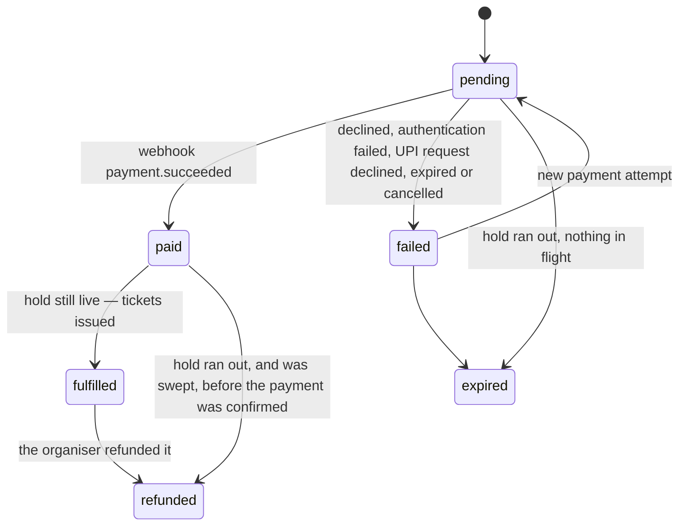

# API

The HTTP API the app uses. It is served by the in-browser backend, but nothing about it
is browser-specific: it's plain JSON over HTTP, defined by the schemas in
[`src/contract/`](../src/contract).

## Conventions

- **Bodies** are JSON; timestamps are ISO 8601 strings; money is an integer amount in
  minor units (`…Minor`) together with its ISO 4217 `currency`.
- **Errors** are `application/problem+json`
  ([RFC 9457](https://www.rfc-editor.org/rfc/rfc9457)): `type`, `title`, `status`,
  `detail`, `instance` and a machine-readable `code`. Branch on `code`; show `detail` to
  people. `type` is an absolute URL to the problem's documentation page,
  `<origin>/problems/<slug>` (`sold_out` → `/problems/sold-out`); `instance` is the
  request's absolute URL.
- **Idempotency:** `POST /api/orders/:orderId/payments` requires an `Idempotency-Key`
  header. The response to an attempted payment is stored and replayed for any repeat of
  the same request: the same method, path and body. The request is compared by a
  fingerprint, never stored: an HMAC-SHA256 under a server secret (`FINGERPRINT_SECRET`),
  over the body with the CVC left out, as PCI DSS requires. So a retry that only
  corrects a CVC is the same request. The same key with a different request is a
  `422 idempotency_key_reused`. The key is claimed before anything is charged, so a
  repeat that arrives while the first request is still being handled is a
  `409 idempotency_key_in_use` (as the IETF Idempotency-Key draft specifies): send it
  again in a moment for the first request's answer. Requests rejected before charging
  aren't stored, and keys expire after 24 hours, as Stripe's do.
- **Orders** need no key: one order per hold makes `POST /api/orders` a natural upsert.
- **Limits:** a body over 64 KB is `413 payload_too_large`. Names are at most 100
  characters, emails 254, and a name on a card 100; a hold names each tier at most once.
  Anything past those is `422 invalid_request`.
- **When the server can't answer:** `503 service_unavailable`, with `Retry-After`, means
  the database couldn't take the request just now (it was tried three times); try again
  after that many seconds. Anything unexpected is `500 internal_error`, still as a
  problem. In the sandbox, `503 backend_restarting` means the browser stopped its
  service worker; the app's client starts the backend again and retries once.
- **Rate limits:** reservation attempts (`POST /api/holds`) are limited per client with a
  sliding window — 20 a minute normally, 3 every 15 seconds in the "Too many attempts"
  scenario. Refused attempts count too. In server mode a client is its IP, from the
  header a trusted proxy sets (`x-forwarded-for` on Vercel, or
  `TRUSTED_CLIENT_IP_HEADER`); without one, there's no limit. A refusal is `429 rate_limited` with a
  `Retry-After` header in seconds (RFC 6585, RFC 9110) and `Cache-Control: no-store`;
  waiting exactly that long always works.

## Endpoints

| Method and path                           | Body                                                                                             | Success                                                                             | Problems                                                                                                                                                                                                                                                                           |
| ----------------------------------------- | ------------------------------------------------------------------------------------------------ | ----------------------------------------------------------------------------------- | ---------------------------------------------------------------------------------------------------------------------------------------------------------------------------------------------------------------------------------------------------------------------------------- |
| `GET /api/events`                         | —                                                                                                | `200` `EventDto[]` with live `available` per tier                                   | —                                                                                                                                                                                                                                                                                  |
| `GET /api/events/:slug`                   | —                                                                                                | `200` `EventDto`                                                                    | `not_found`                                                                                                                                                                                                                                                                        |
| `POST /api/events/:slug/queue`            | —                                                                                                | `201` a new place / `200` your existing one, `QueueEntryDto`                        | `not_found`, `invalid_state` (no queue right now)                                                                                                                                                                                                                                  |
| `GET /api/queue/:token`                   | —                                                                                                | `200` `QueueEntryDto`                                                               | `not_found`                                                                                                                                                                                                                                                                        |
| `GET /api/events/:slug/seats`             | —                                                                                                | `200` `{ eventSlug, unavailableSeatIds, serverTime }`                               | `not_found` (no such event, or no reserved seating)                                                                                                                                                                                                                                |
| `POST /api/holds`                         | `{ eventSlug, items: [{ tierId, quantity }] }`, or `{ eventSlug, seatIds }` for reserved seating | `201` `HoldDetailsDto` (`hold`, `event`, `order`, `serverTime`)                     | `invalid_request`, `not_found`, `sold_out` (`tierId`, `available`), `seats_unavailable` (`seatIds`), `single_seat_gap` (`seatIds`), `rate_limited` (`retryAfterSeconds`), `queue_required` (`eventSlug`)                                                                           |
| `GET /api/holds/:holdId`                  | —                                                                                                | `200` `HoldDetailsDto`                                                              | `not_found`                                                                                                                                                                                                                                                                        |
| `POST /api/orders`                        | `{ holdId, attendees: [{ name, email }], addOns: { [addOnId]: quantity } }`                      | `201` created / `200` updated, `OrderDto`                                           | `invalid_request`, `not_found`, `hold_expired`, `payment_in_progress`, `already_completed`                                                                                                                                                                                         |
| `GET /api/orders/:orderId`                | —                                                                                                | `200` `OrderDto`                                                                    | `not_found`                                                                                                                                                                                                                                                                        |
| `POST /api/orders/:orderId/payments`      | `{ method?: "card", number, expiry, cvc, name }` or `{ method: "upi" }`, + `Idempotency-Key`     | `202` `{ payment, order }` — `processing`, or `requires_action` with a `nextAction` | `missing_idempotency_key`, `idempotency_key_reused`, `idempotency_key_in_use`, `invalid_card`, `invalid_request` (UPI), `payment_method_unavailable` (UPI, in server mode), `card_declined` (`paymentId`), `hold_expired`, `payment_in_progress`, `already_completed`, `not_found` |
| `POST /api/payments/:paymentId/challenge` | `{ decision: "approve" \| "reject" }`                                                            | `202` `{ payment, order }`                                                          | `authentication_failed` (`paymentId`), `invalid_state`, `not_found`                                                                                                                                                                                                                |
| `POST /api/payments/:paymentId/cancel`    | —                                                                                                | `200` `{ payment, order }` — failed, `cancelled`; the same again if repeated        | `invalid_state` (already approved, or over), `not_found`                                                                                                                                                                                                                           |

A `202` never means "paid". The order becomes `paid` and then `fulfilled` when the
provider's webhook arrives; poll `GET /api/orders/:orderId` until its `status` settles.

A payment is `{ id, method, status, last4, failureCode, nextAction }`. While its status
is `requires_action`, `nextAction` says what the buyer must do: `{ type:
"card_challenge" }` for 3-D Secure, or `{ type: "upi", intentUri, expiresAt }`. `last4`
is `null` for UPI.

## Prices and tax

Every price is all in: what a buyer sees first is what they pay
([ADR 012](decisions/012-gst-and-all-in-pricing.md)). An order's `amounts` are:

- `ticketsMinor` and `addOnsMinor`, before tax;
- `feesMinor`, the booking fee: 3% of each ticket;
- `taxMinor`, the sum of `taxLines`;
- `totalMinor`, what's charged.

Each tax line is `{ kind, rateBasisPoints, taxableMinor, amountMinor }`, with `kind`
one of `tickets`, `tickets-exempt` (admission of ₹500 or less, at 0%), `booking-fee`
or `add-ons` (one line per rate). GST is 18% on admission and on the fee. It's worked
out per ticket in paise, rounding half-up, as CGST and SGST halves each rounded. One
ticket's all-in price times the quantity is exactly that line's cost.

## Paying by UPI

For orders in rupees ([ADR 013](decisions/013-upi-by-intent-and-qr.md)):

1. **Ask for a request:** `POST /api/orders/:orderId/payments` with `{ "method": "upi" }`
   and an `Idempotency-Key`. The answer is `202`, with the payment in `requires_action`
   and `nextAction: { type: "upi", intentUri, expiresAt }`. A body with anything else
   in it, such as the buyer's UPI ID for a "collect" request, is `422 invalid_request`.
   Merchants can no longer collect.
2. **Show it:** open `intentUri` (a `upi://pay` link) on a phone, or show it as a QR
   code to scan on a computer.
3. **Wait:** the buyer approves or declines in their UPI app, outside this API. Poll
   `GET /api/orders/:orderId`. Once approved, the payment is `processing` and the order
   settles by webhook, as for a card. A declined payment is `failed` with `upi_declined`.
4. **Or give up:** after `expiresAt` (5 minutes, never past the hold), the payment reads
   as `failed` with `upi_expired`. `POST /api/payments/:paymentId/cancel` ends it
   sooner, with `cancelled`. Either way, a new payment can follow.

## Waiting room

When a sale is in high demand (the "Flash sale" scenario), every event's
`isQueueActive` is `true` and reserving needs a turn:

- **Join:** `POST /api/events/:slug/queue` returns a place:
  `{ token, status, aheadCount, aheadAtJoin, estimatedWaitSeconds,
checkAgainAfterSeconds, admittedUntil, serverTime }`. Joining again while the place is
  live returns the same one, so a refresh never sends you to the back.
- **Wait:** `GET /api/queue/:token`, no sooner than `checkAgainAfterSeconds` — the
  server sets the pace. The line is first in, first out, and moves a batch at a time. A
  place is computed from when it was taken and the clock, so it can't drift.
- **Reserve:** send the token as a `Queue-Token` header on `POST /api/holds`. While
  `status` is `waiting`, or once it's `expired` (the admission window is 10 minutes), or
  for another sale's queue, the answer is `403 queue_required` with the `eventSlug` to
  queue for.

## Reserved seating

An event's `seating` is `{ kind: "general" }` or `{ kind: "reserved", venueId }`. For
reserved seating, the hall's layout is static content, shipped with the app like the
catalogue (`src/core/venues.ts`); only what changes comes from the API.

- **Availability:** `GET /api/events/:slug/seats` lists the seats that are gone — sold, or
  in someone's live hold. Every other seat in the hall is free. An expired hold's seats
  are free at once.
- **Choosing seats:** `POST /api/holds` with `seatIds` (1–6, each once). It's
  all-or-nothing. If any seat is taken, nothing is held and `409 seats_unavailable`
  lists the taken ones. A selection that would leave one empty seat between itself and
  a taken seat, an aisle or a row end is a `422 single_seat_gap` naming that seat.
- **Best available:** `POST /api/holds` with `items`, the shape general admission uses,
  makes the server choose. It picks the row nearest the stage with the party's seats
  together in one block, as central as possible without stranding a seat; failing that,
  the best seats apart.
- **Seats on the way out:** `HoldDto.seats` and `OrderDto.seats` list the seats as
  `{ id, sectionName, row, number, tierId }`, and each ticket has its `seat` (`null` for
  general admission). These fields are additions: clients that don't know them ignore
  them.

## Tickets

A fulfilled order's `tickets` are `{ code, attendeeName, tierName, seat, token }`. The
`token` is what the door checks, so it's what the ticket's QR code holds
([ADR 019](decisions/019-offline-tickets-and-door-scanner.md)).

- **Format:** `ao1.<kid>.<payload>.<signature>`. The payload is base64url JSON,
  `{ c: code, e: eventSlug, n: attendeeName, t: tierName, s: seat }` (`s` is `null` for
  general admission); the signature is Ed25519 (RFC 8032) over `ao1.<kid>.<payload>`,
  in base64url.
- **Checking one** needs only the public key for its `kid`, and no request, so a door
  can check tickets offline. Anything else is refused: another version, a key id the
  door doesn't know, a payload that isn't the claims.
- **Keys:** the sandbox signs with a public demo key (`demo-2026`), so anyone can make
  tickets its scanner accepts. A server signs with `TICKET_SIGNING_KEY` (key id
  `TICKET_KEY_ID`, by default `server-1`), and its scanner trusts the matching
  `NEXT_PUBLIC_TICKET_PUBLIC_KEY`.
- `token` is an addition: clients that don't know it ignore it.

## The organisers' API

For organisers' dashboards ([ADR 014](decisions/014-organiser-access.md),
[015](decisions/015-reporting-at-scale.md), [016](decisions/016-refunds.md)).

**Signing in.** `POST /api/session` with `{ "accountId": "acc-lakeside-owner" }` (a
demo account) answers `201 { token, account }`. Send the token as
`Authorization: Bearer <token>`. It lasts 8 hours; `DELETE /api/session` ends it
early.

**Statuses.** Every answer is `Cache-Control: no-store`.

- **`401 unauthenticated`** means no token, or one that's no longer valid.
  `WWW-Authenticate` adds `error="invalid_token"` for the second.
- **`403 forbidden`** covers an event that belongs to another organiser, or a
  permission the account's role lacks.
- **`404 not_found`** is what another organiser's order looks like: it isn't confirmed
  to exist.

| Method and path                               | Success                                                                                        | Notes                                                                                                                     |
| --------------------------------------------- | ---------------------------------------------------------------------------------------------- | ------------------------------------------------------------------------------------------------------------------------- |
| `GET /api/organiser/account`                  | `200` `{ id, name, role, organisation, permissions }`                                          |                                                                                                                           |
| `GET /api/organiser/events`                   | `200` the account's events, each with its `permissions`                                        |                                                                                                                           |
| `GET /api/organiser/metrics?event=`           | `200` revenue, tickets by tier, sales by day, the funnel, the payment mix, webhook lag p50/p95 | All the account's events, or one                                                                                          |
| `GET /api/organiser/orders`                   | `200` `{ orders, nextPageToken, totalSize }`                                                   | See below                                                                                                                 |
| `GET /api/organiser/orders/export`            | `200` `text/csv`, as an attachment                                                             | The same filters, every match, no paging                                                                                  |
| `GET /api/organiser/orders/:orderId`          | `200` the order in full, with its refunds                                                      | `404` for another organiser's                                                                                             |
| `POST /api/organiser/orders/:orderId/refunds` | `202` `{ refund, order }`, the refund `pending`                                                | `{ reason }` + `Idempotency-Key`; `409` if refunded already or not fulfilled; `502 refund_failed` if the provider refuses |
| `GET /api/organiser/events/:slug/door`        | `200` `{ eventSlug, voidedCodes, asOf }`                                                       | The event's refunded ticket codes, for its door scanners; needs `orders:read` on the event                                |
| `GET /api/organiser/stream`                   | `200` `text/event-stream`                                                                      | Send `Accept: text/event-stream`                                                                                          |

**Listing orders.** The parameters, all optional:

- **Filters:** `event`, `status` (repeat it for more than one), `method` (`upi` or
  `card`), `from` and `to` (calendar days in the organisation's time zone, inclusive),
  and `q` (an order id, or part of a name or email).
- **Sorting:** `orderBy` is `createdAt`, `totalMinor`, `buyerName` or `ticketCount`,
  then `asc` or `desc` (AIP-132; the default is `createdAt desc`).
- **Paging:** `pageSize` (1–200, default 50) and `pageToken`.

Pass the `nextPageToken` back as `pageToken` with otherwise the same query (AIP-158).
It's `null` on the last page, and a token used with other filters is a `422`. A query
that can't be honoured, such as an unknown sort, is a `422` too.

**The stream.**

- An `ordersChanged` event names the account's events whose orders, sales or refunds
  changed: `data: {"eventSlugs":["lakeside-lights"]}`. Re-read what you're showing;
  the event carries no data.
- A `: heartbeat` comment comes every 15 seconds.
- Read it with `fetch`, since `EventSource` can't send the `Authorization` header.

**Refunds.** A refund is settled by the provider's `refund.succeeded` webhook. Then
the order is `refunded`, and its tickets go back on sale. The tickets themselves are
voided, not deleted: each is a signed token that a door checks offline, so a door
learns of a refund from the event's list of voided codes (`…/door`), which it fetches
while online ([ADR 019](decisions/019-offline-tickets-and-door-scanner.md)).

## Webhooks, in server mode

`POST /api/webhooks/payments` is where the payment provider tells the server what
happened to a payment. The sandbox has no such endpoint: its provider runs in the same
page and delivers in-process.

- **Signed:** `Webhook-Signature: t=<unix seconds>,v1=<hex HMAC-SHA256 of "t.body">`,
  under a secret shared with the provider (`WEBHOOK_SECRET`). A header may carry several
  `v1=` values, one per secret, so the secret can be rotated.
- **Checked before anything is parsed:** over the raw body, with a constant-time compare,
  and refused if `t` is more than five minutes from now. A webhook that fails any check
  is a `400 invalid_signature`, and nothing happens.
- **Acted on once,** by event id: a repeat is acknowledged (`200`, `"outcome": "duplicate"`)
  and changes nothing. An event about a payment the server doesn't know yet is a `404
not_found`, and isn't recorded, so the provider sends it again later.
- **Judged when it happened:** a payment the provider confirmed while its hold was
  live keeps its tickets, however late the event arrives.
- **Delivery,** from the simulated provider: right after a payment's response, when the
  buyer next reads the order, and from `GET /api/internal/deliver`, which a scheduler
  should call every minute or so with `Authorization: Bearer $CRON_SECRET` (without
  `CRON_SECRET`, the route is a 404). A delivery that fails is tried again, backing off
  from a second to a minute, ten times at most.
- **Sandbox-only routes** (the waiting room, the organisers' API) answer
  `501 not_in_server_mode` in server mode.

## Order lifecycle

Any other transition is a bug and throws (`assertTransition`).

## Test cards

| Number                | Outcome                                  |
| --------------------- | ---------------------------------------- |
| `4242 4242 4242 4242` | Succeeds                                 |
| `4000 0000 0000 0002` | Declined (`402 card_declined`)           |
| `4000 0025 0000 3155` | 3-D Secure challenge (`requires_action`) |
