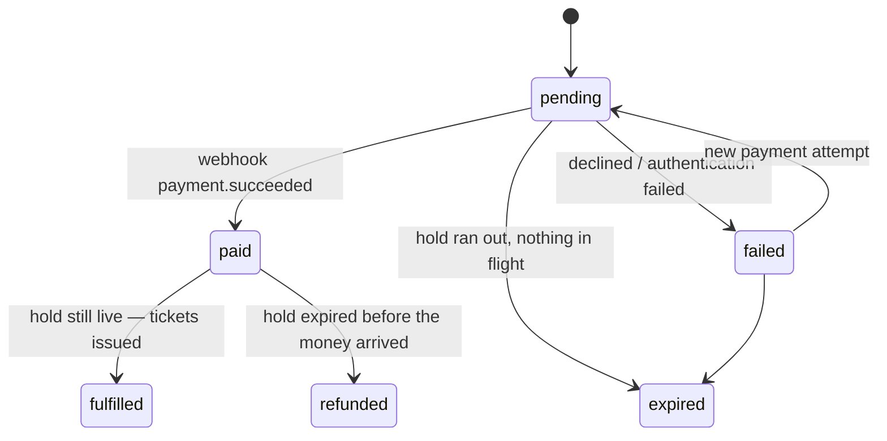

# API

The HTTP API the app uses. It is served by the in-browser backend, but nothing about it
is browser-specific: it's plain JSON over HTTP, defined by the schemas in
[`src/contract/`](../src/contract).

## Conventions

- **Bodies** are JSON; timestamps are ISO 8601 strings; money is an integer amount in
  minor units (`…Minor`) together with its ISO 4217 `currency`.
- **Errors** are `application/problem+json`
  ([RFC 9457](https://www.rfc-editor.org/rfc/rfc9457)): `type`, `title`, `status`,
  `detail`, `instance` and a machine-readable `code`. Branch on `code`; show `detail` to
  people. `type` is an absolute URL to the problem's documentation page,
  `<origin>/problems/<slug>` (`sold_out` → `/problems/sold-out`); `instance` is the
  request's absolute URL.
- **Idempotency:** `POST /api/orders/:orderId/payments` requires an `Idempotency-Key`
  header. The response to an attempted charge is stored and replayed for any repeat of
  the same request — the same method, path and body, every field compared (by SHA-256
  hash, so no card details are stored). The same key with a different request is a
  `422 idempotency_key_reused`. Requests rejected before charging aren't stored, and keys
  expire after 24 hours, as Stripe's do.
- **Orders** need no key: one order per hold makes `POST /api/orders` a natural upsert.
- **Rate limits:** reservation attempts (`POST /api/holds`) are limited per client with a
  sliding window — 20 a minute normally, 3 every 15 seconds in the "Too many attempts"
  scenario. Refused attempts count too. A refusal is `429 rate_limited` with a
  `Retry-After` header in seconds (RFC 6585, RFC 9110) and `Cache-Control: no-store`;
  waiting exactly that long always works.

## Endpoints

| Method and path                           | Body                                                                                             | Success                                                                        | Problems                                                                                                                                                                    |
| ----------------------------------------- | ------------------------------------------------------------------------------------------------ | ------------------------------------------------------------------------------ | --------------------------------------------------------------------------------------------------------------------------------------------------------------------------- |
| `GET /api/events`                         | —                                                                                                | `200` `EventDto[]` with live `available` per tier                              | —                                                                                                                                                                           |
| `GET /api/events/:slug`                   | —                                                                                                | `200` `EventDto`                                                               | `not_found`                                                                                                                                                                 |
| `GET /api/events/:slug/seats`             | —                                                                                                | `200` `{ eventSlug, unavailableSeatIds, serverTime }`                          | `not_found` (no such event, or no reserved seating)                                                                                                                         |
| `POST /api/holds`                         | `{ eventSlug, items: [{ tierId, quantity }] }`, or `{ eventSlug, seatIds }` for reserved seating | `201` `HoldDetailsDto` (`hold`, `event`, `order`, `serverTime`)                | `invalid_request`, `not_found`, `sold_out` (`tierId`, `available`), `seats_unavailable` (`seatIds`), `single_seat_gap` (`seatIds`), `rate_limited` (`retryAfterSeconds`)    |
| `GET /api/holds/:holdId`                  | —                                                                                                | `200` `HoldDetailsDto`                                                         | `not_found`                                                                                                                                                                 |
| `POST /api/orders`                        | `{ holdId, attendees: [{ name, email }], addOns: { [addOnId]: quantity } }`                      | `201` created / `200` updated, `OrderDto`                                      | `invalid_request`, `not_found`, `hold_expired`, `payment_in_progress`, `already_completed`                                                                                  |
| `GET /api/orders/:orderId`                | —                                                                                                | `200` `OrderDto`                                                               | `not_found`                                                                                                                                                                 |
| `POST /api/orders/:orderId/payments`      | `{ number, expiry, cvc, name }` + `Idempotency-Key`                                              | `202` `{ payment, order }` — `processing`, or `requires_action` for 3-D Secure | `missing_idempotency_key`, `idempotency_key_reused`, `invalid_card`, `card_declined` (`paymentId`), `hold_expired`, `payment_in_progress`, `already_completed`, `not_found` |
| `POST /api/payments/:paymentId/challenge` | `{ decision: "approve" \| "reject" }`                                                            | `202` `{ payment, order }`                                                     | `authentication_failed` (`paymentId`), `invalid_state`, `not_found`                                                                                                         |

A `202` never means "paid". The order becomes `paid` and then `fulfilled` when the
provider's webhook arrives; poll `GET /api/orders/:orderId` until its `status` settles.

## Reserved seating

An event's `seating` is `{ kind: "general" }` or `{ kind: "reserved", venueId }`. For
reserved seating, the hall's layout is static content, shipped with the app like the
catalogue (`src/core/venues.ts`); only what changes comes from the API.

- **Availability:** `GET /api/events/:slug/seats` lists the seats that are gone — sold, or
  in someone's live hold. Every other seat in the hall is free. An expired hold's seats
  are free at once.
- **Choosing seats:** `POST /api/holds` with `seatIds` (1–6, each once). It's
  all-or-nothing. If any seat is taken, nothing is held and `409 seats_unavailable`
  lists the taken ones. A selection that would leave one empty seat between itself and
  a taken seat, an aisle or a row end is a `422 single_seat_gap` naming that seat.
- **Best available:** `POST /api/holds` with `items`, the shape general admission uses,
  makes the server choose. It picks the row nearest the stage with the party's seats
  together in one block, as central as possible without stranding a seat; failing that,
  the best seats apart.
- **Seats on the way out:** `HoldDto.seats` and `OrderDto.seats` list the seats as
  `{ id, sectionName, row, number, tierId }`, and each ticket has its `seat` (`null` for
  general admission). These fields are additions: clients that don't know them ignore
  them.

## Order lifecycle

Any other transition is a bug and throws (`assertTransition`).

## Test cards

| Number                | Outcome                                  |
| --------------------- | ---------------------------------------- |
| `4242 4242 4242 4242` | Succeeds                                 |
| `4000 0000 0000 0002` | Declined (`402 card_declined`)           |
| `4000 0025 0000 3155` | 3-D Secure challenge (`requires_action`) |
