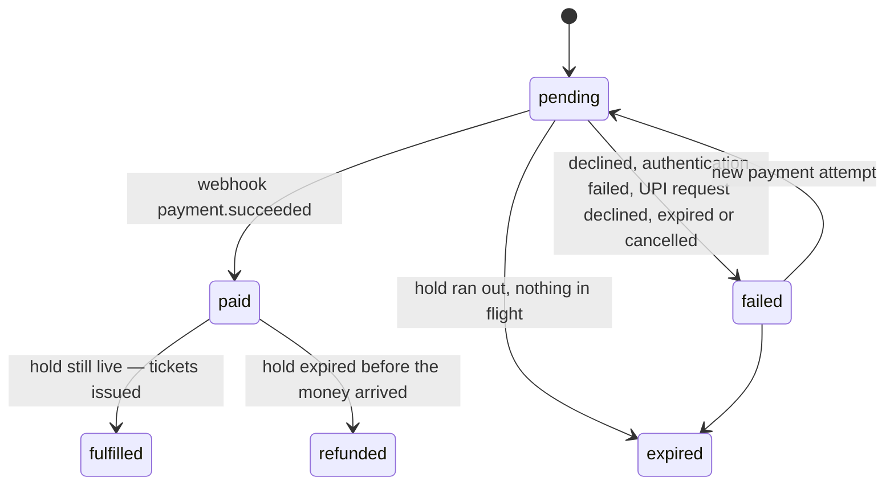

# API

The HTTP API the app uses. It is served by the in-browser backend, but nothing about it
is browser-specific: it's plain JSON over HTTP, defined by the schemas in
[`src/contract/`](../src/contract).

## Conventions

- **Bodies** are JSON; timestamps are ISO 8601 strings; money is an integer amount in
  minor units (`…Minor`) together with its ISO 4217 `currency`.
- **Errors** are `application/problem+json`
  ([RFC 9457](https://www.rfc-editor.org/rfc/rfc9457)): `type`, `title`, `status`,
  `detail`, `instance` and a machine-readable `code`. Branch on `code`; show `detail` to
  people. `type` is an absolute URL to the problem's documentation page,
  `<origin>/problems/<slug>` (`sold_out` → `/problems/sold-out`); `instance` is the
  request's absolute URL.
- **Idempotency:** `POST /api/orders/:orderId/payments` requires an `Idempotency-Key`
  header. The response to an attempted payment is stored and replayed for any repeat of
  the same request — the same method, path and body, every field compared (by SHA-256
  hash, so no card details are stored). The same key with a different request is a
  `422 idempotency_key_reused`. Requests rejected before charging aren't stored, and keys
  expire after 24 hours, as Stripe's do.
- **Orders** need no key: one order per hold makes `POST /api/orders` a natural upsert.
- **Rate limits:** reservation attempts (`POST /api/holds`) are limited per client with a
  sliding window — 20 a minute normally, 3 every 15 seconds in the "Too many attempts"
  scenario. Refused attempts count too. A refusal is `429 rate_limited` with a
  `Retry-After` header in seconds (RFC 6585, RFC 9110) and `Cache-Control: no-store`;
  waiting exactly that long always works.

## Endpoints

| Method and path                           | Body                                                                                             | Success                                                                             | Problems                                                                                                                                                                                                 |
| ----------------------------------------- | ------------------------------------------------------------------------------------------------ | ----------------------------------------------------------------------------------- | -------------------------------------------------------------------------------------------------------------------------------------------------------------------------------------------------------- |
| `GET /api/events`                         | —                                                                                                | `200` `EventDto[]` with live `available` per tier                                   | —                                                                                                                                                                                                        |
| `GET /api/events/:slug`                   | —                                                                                                | `200` `EventDto`                                                                    | `not_found`                                                                                                                                                                                              |
| `POST /api/events/:slug/queue`            | —                                                                                                | `201` a new place / `200` your existing one, `QueueEntryDto`                        | `not_found`, `invalid_state` (no queue right now)                                                                                                                                                        |
| `GET /api/queue/:token`                   | —                                                                                                | `200` `QueueEntryDto`                                                               | `not_found`                                                                                                                                                                                              |
| `GET /api/events/:slug/seats`             | —                                                                                                | `200` `{ eventSlug, unavailableSeatIds, serverTime }`                               | `not_found` (no such event, or no reserved seating)                                                                                                                                                      |
| `POST /api/holds`                         | `{ eventSlug, items: [{ tierId, quantity }] }`, or `{ eventSlug, seatIds }` for reserved seating | `201` `HoldDetailsDto` (`hold`, `event`, `order`, `serverTime`)                     | `invalid_request`, `not_found`, `sold_out` (`tierId`, `available`), `seats_unavailable` (`seatIds`), `single_seat_gap` (`seatIds`), `rate_limited` (`retryAfterSeconds`), `queue_required` (`eventSlug`) |
| `GET /api/holds/:holdId`                  | —                                                                                                | `200` `HoldDetailsDto`                                                              | `not_found`                                                                                                                                                                                              |
| `POST /api/orders`                        | `{ holdId, attendees: [{ name, email }], addOns: { [addOnId]: quantity } }`                      | `201` created / `200` updated, `OrderDto`                                           | `invalid_request`, `not_found`, `hold_expired`, `payment_in_progress`, `already_completed`                                                                                                               |
| `GET /api/orders/:orderId`                | —                                                                                                | `200` `OrderDto`                                                                    | `not_found`                                                                                                                                                                                              |
| `POST /api/orders/:orderId/payments`      | `{ method?: "card", number, expiry, cvc, name }` or `{ method: "upi" }`, + `Idempotency-Key`     | `202` `{ payment, order }` — `processing`, or `requires_action` with a `nextAction` | `missing_idempotency_key`, `idempotency_key_reused`, `invalid_card`, `invalid_request` (UPI), `card_declined` (`paymentId`), `hold_expired`, `payment_in_progress`, `already_completed`, `not_found`     |
| `POST /api/payments/:paymentId/challenge` | `{ decision: "approve" \| "reject" }`                                                            | `202` `{ payment, order }`                                                          | `authentication_failed` (`paymentId`), `invalid_state`, `not_found`                                                                                                                                      |
| `POST /api/payments/:paymentId/cancel`    | —                                                                                                | `200` `{ payment, order }` — failed, `cancelled`; the same again if repeated        | `invalid_state` (already approved, or over), `not_found`                                                                                                                                                 |

A `202` never means "paid". The order becomes `paid` and then `fulfilled` when the
provider's webhook arrives; poll `GET /api/orders/:orderId` until its `status` settles.

A payment is `{ id, method, status, last4, failureCode, nextAction }`. While its status
is `requires_action`, `nextAction` says what the buyer must do: `{ type:
"card_challenge" }` for 3-D Secure, or `{ type: "upi", intentUri, expiresAt }`. `last4`
is `null` for UPI.

## Prices and tax

Every price is all in: what a buyer sees first is what they pay
([ADR 012](decisions/012-gst-and-all-in-pricing.md)). An order's `amounts` are:

- `ticketsMinor` and `addOnsMinor`, before tax;
- `feesMinor`, the booking fee: 3% of each ticket;
- `taxMinor`, the sum of `taxLines`;
- `totalMinor`, what's charged.

Each tax line is `{ kind, rateBasisPoints, taxableMinor, amountMinor }`, with `kind`
one of `tickets`, `tickets-exempt` (admission of ₹500 or less, at 0%), `booking-fee`
or `add-ons` (one line per rate). GST is 18% on admission and on the fee. It's worked
out per ticket in paise, rounding half-up, as CGST and SGST halves each rounded. One
ticket's all-in price times the quantity is exactly that line's cost.

## Paying by UPI

For orders in rupees ([ADR 013](decisions/013-upi-by-intent-and-qr.md)):

1. **Ask for a request:** `POST /api/orders/:orderId/payments` with `{ "method": "upi" }`
   and an `Idempotency-Key`. The answer is `202`, with the payment in `requires_action`
   and `nextAction: { type: "upi", intentUri, expiresAt }`. A body with anything else
   in it, such as the buyer's UPI ID for a "collect" request, is `422 invalid_request`.
   Merchants can no longer collect.
2. **Show it:** open `intentUri` (a `upi://pay` link) on a phone, or show it as a QR
   code to scan on a computer.
3. **Wait:** the buyer approves or declines in their UPI app, outside this API. Poll
   `GET /api/orders/:orderId`. Once approved, the payment is `processing` and the order
   settles by webhook, as for a card. A declined payment is `failed` with `upi_declined`.
4. **Or give up:** after `expiresAt` (5 minutes, never past the hold), the payment reads
   as `failed` with `upi_expired`. `POST /api/payments/:paymentId/cancel` ends it
   sooner, with `cancelled`. Either way, a new payment can follow.

## Waiting room

When a sale is in high demand (the "Flash sale" scenario), every event's
`isQueueActive` is `true` and reserving needs a turn:

- **Join:** `POST /api/events/:slug/queue` returns a place:
  `{ token, status, aheadCount, aheadAtJoin, estimatedWaitSeconds,
checkAgainAfterSeconds, admittedUntil, serverTime }`. Joining again while the place is
  live returns the same one, so a refresh never sends you to the back.
- **Wait:** `GET /api/queue/:token`, no sooner than `checkAgainAfterSeconds` — the
  server sets the pace. The line is first in, first out, and moves a batch at a time. A
  place is computed from when it was taken and the clock, so it can't drift.
- **Reserve:** send the token as a `Queue-Token` header on `POST /api/holds`. While
  `status` is `waiting`, or once it's `expired` (the admission window is 10 minutes), or
  for another sale's queue, the answer is `403 queue_required` with the `eventSlug` to
  queue for.

## Reserved seating

An event's `seating` is `{ kind: "general" }` or `{ kind: "reserved", venueId }`. For
reserved seating, the hall's layout is static content, shipped with the app like the
catalogue (`src/core/venues.ts`); only what changes comes from the API.

- **Availability:** `GET /api/events/:slug/seats` lists the seats that are gone — sold, or
  in someone's live hold. Every other seat in the hall is free. An expired hold's seats
  are free at once.
- **Choosing seats:** `POST /api/holds` with `seatIds` (1–6, each once). It's
  all-or-nothing. If any seat is taken, nothing is held and `409 seats_unavailable`
  lists the taken ones. A selection that would leave one empty seat between itself and
  a taken seat, an aisle or a row end is a `422 single_seat_gap` naming that seat.
- **Best available:** `POST /api/holds` with `items`, the shape general admission uses,
  makes the server choose. It picks the row nearest the stage with the party's seats
  together in one block, as central as possible without stranding a seat; failing that,
  the best seats apart.
- **Seats on the way out:** `HoldDto.seats` and `OrderDto.seats` list the seats as
  `{ id, sectionName, row, number, tierId }`, and each ticket has its `seat` (`null` for
  general admission). These fields are additions: clients that don't know them ignore
  them.

## Order lifecycle

Any other transition is a bug and throws (`assertTransition`).

## Test cards

| Number                | Outcome                                  |
| --------------------- | ---------------------------------------- |
| `4242 4242 4242 4242` | Succeeds                                 |
| `4000 0000 0000 0002` | Declined (`402 card_declined`)           |
| `4000 0025 0000 3155` | 3-D Secure challenge (`requires_action`) |
