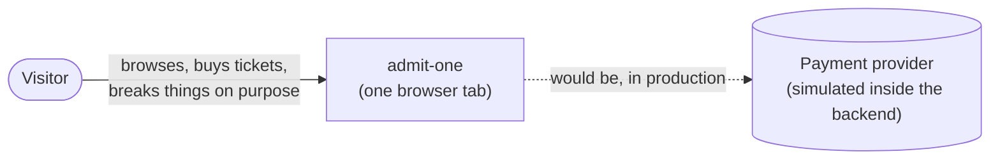
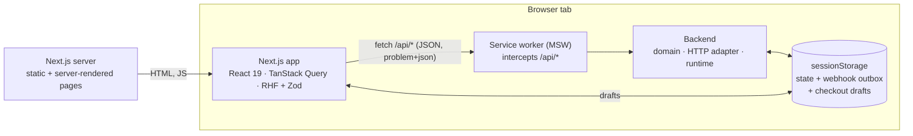
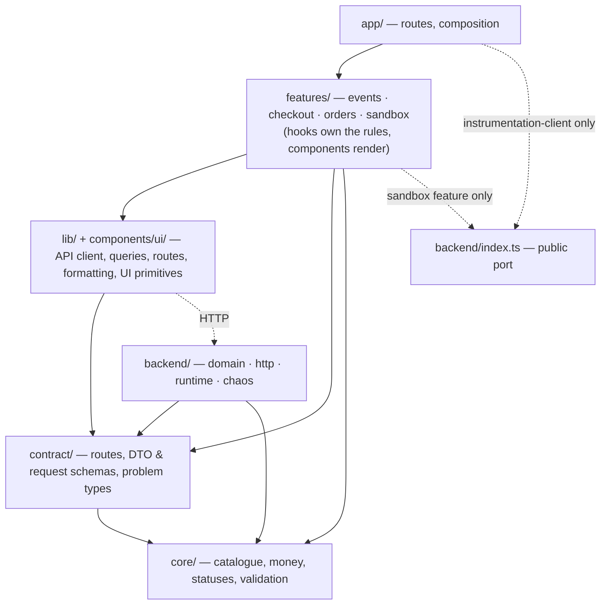
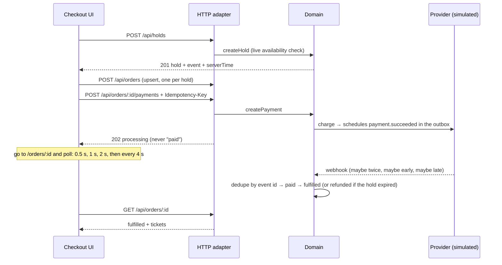

# Architecture

admit-one is an event-ticketing checkout whose backend runs in the visitor's browser,
behind a real HTTP boundary. This page describes the system at three zoom levels
(after the [C4 model](https://c4model.com)), then the rules that keep it that way.
Decisions and their reasons live in [`decisions/`](decisions).

## 1. Context

There are no external systems: the payment provider, its webhooks and the other buyers
(the "crowd") are simulated inside the backend, so anyone can run the demo with no
accounts, keys or cost — and every tab gets its own sandbox.

## 2. Containers

- **The app** never imports the backend. It talks to `/api/*` with `fetch`, exactly as it
  would to a remote service, and parses every response against the contract.
- **The backend** starts in `src/instrumentation-client.ts`, before the app is
  interactive; the API client holds requests until its service worker answers.
- **State** is persisted after every command, including webhooks still waiting in the
  outbox, so a reload mid-payment resumes exactly where it was.

## 3. Components: the layers

| Layer             | Responsibility                                                                                                                                                                         | May import                              |
| ----------------- | -------------------------------------------------------------------------------------------------------------------------------------------------------------------------------------- | --------------------------------------- |
| `core/`           | The shared kernel: the event catalogue and its halls, seat geometry and the single-seat-gap rule, money and pricing, lifecycle vocabularies, validation rules, order-status predicates | nothing else                            |
| `contract/`       | The HTTP contract: route table, DTO and request schemas, RFC 9457 problem types                                                                                                        | `core`                                  |
| `backend/domain`  | Inventory, orders, payments, webhooks, the order state machine — plain functions over plain state, with time, ids and randomness injected                                              | `core`, `contract`                      |
| `backend/http`    | The adapter: request parsing, status codes, problem details, idempotency keys, ISO timestamps                                                                                          | the domain                              |
| `backend/runtime` | The MSW worker, persistence, and timers for webhooks and the crowd                                                                                                                     | the domain, the adapter                 |
| `lib/`            | The API client (the anti-corruption layer), query factories, routes, safe storage, formatting                                                                                          | `core`, `contract`                      |
| `components/ui/`  | Design-system primitives: `Button`, `TextField`, `Notice`, `ErrorState`, …                                                                                                             | `lib`, `core`                           |
| `features/*`      | View-model hooks (`useCheckout`, `useOrderStatus`, `usePayment`, `useReserveTickets`) and the components that render them                                                              | everything above; never another feature |
| `app/`            | Routes and error boundaries; composes features                                                                                                                                         | everything except backend internals     |

**The rule is enforced, not just described.** `eslint.config.mjs` declares these as
`import/no-restricted-paths` zones (plus `import/no-cycle`), so a forbidden import fails
lint and CI with a message saying why.

## 4. How a purchase flows

## 5. Cross-cutting decisions

- **Errors** are RFC 9457 problem details with a typed `code`; the domain never picks a
  status ([006](decisions/006-problem-details.md)).
- **The contract is schema-first**: Zod schemas parsed at both ends, ISO 8601 on the
  wire, `…Ms` inside ([007](decisions/007-typed-contract-and-iso-times.md)).
- **Money and time zones are data** ([008](decisions/008-money-and-time-zones.md)).
- **Reserved seating** — halls are static data in `core` and server-rendered; which
  seats are gone comes over HTTP. Holds by seat are all-or-nothing, and the server
  chooses "best available" in the same step as the hold
  ([010](decisions/010-reserved-seating.md)).
- **Security headers** — a Content Security Policy without nonces, so pages stay static,
  plus the usual hardening headers ([009](decisions/009-security-headers.md)).
- **Failures are contained and reported.** `app/error.tsx` covers every route and keeps
  the header; `global-error.tsx` covers the root layout; an `ErrorBoundary` contains the
  chaos panel, which lives in the root layout. Render errors, and query or mutation
  failures that aren't a server's answer, go to `lib/monitoring.ts` — the one place to
  connect Sentry — along with Core Web Vitals.
- **UI state is a union**: each view-model hook returns exactly one state (`loading`,
  `expired`, `ready`, …), rendered with an exhaustive `switch` — no booleans to combine
  into impossible states.

## 6. Testing strategy

Following the testing trophy, most confidence comes from tests that use the system the
way it's used:

| Layer       | Tests                                                                                                                        | Where                                          |
| ----------- | ---------------------------------------------------------------------------------------------------------------------------- | ---------------------------------------------- |
| Static      | strict TypeScript, type-aware ESLint (naming, boundaries, exhaustiveness)                                                    | every commit, CI                               |
| Unit        | domain rules on a fake clock; pure view-model derivations; money, schemas, countdown                                         | `*.test.ts` next to each module                |
| Integration | the HTTP contract through real `fetch` and MSW; the API client against a mock network; components with Testing Library       | `backend/http`, `lib`, `features/*/components` |
| End-to-end  | one Playwright test per chaos preset, plus guards, expiry, refresh-resume, focus, axe in both themes, 375 px, reduced motion | `e2e/` — page objects in `e2e/fixtures.ts`     |

## What a production version would change

- A real database: the availability check and hold insert become one transaction (or a
  conditional `UPDATE … WHERE available >= quantity`), and webhook dedupe a unique insert.
- A real provider adapter behind the same payment port, with webhook signature
  verification (HMAC over the raw body, with a timestamp check against replay).
- Authentication, rate limiting on holds, email delivery, and observability on webhook
  lag. None of these are half-built here; they're next steps.
