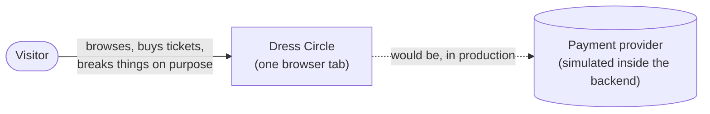
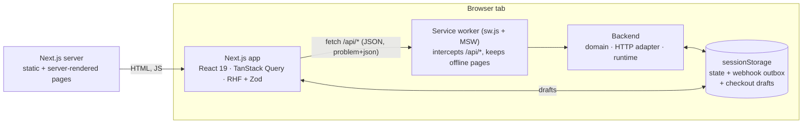
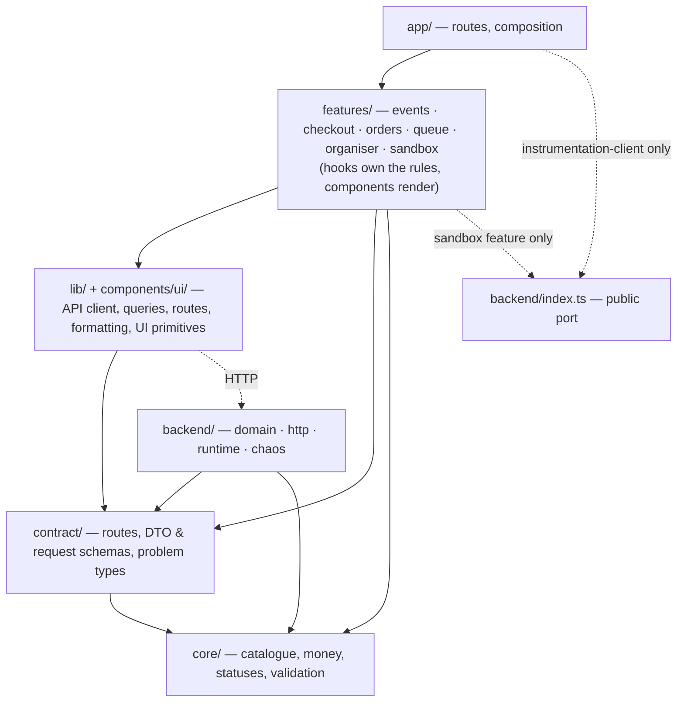
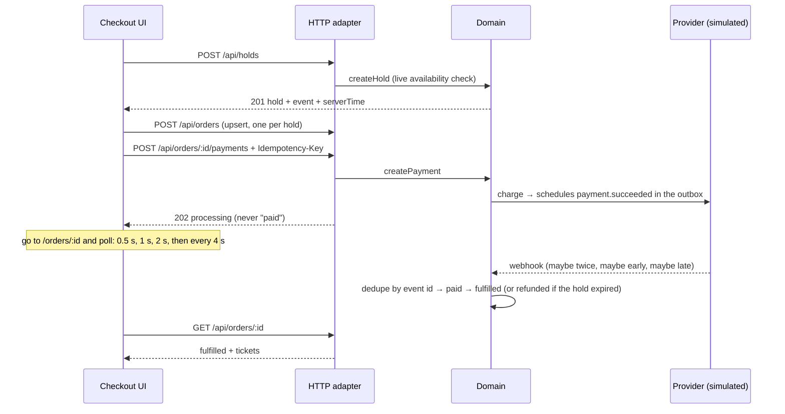

# Architecture

Dress Circle is an event-ticketing checkout whose backend runs in the visitor's browser,
behind a real HTTP boundary. This page describes the system at three zoom levels
(after the [C4 model](https://c4model.com)), then the rules that keep it that way.
Decisions and their reasons live in [`decisions/`](decisions).

## 1. Context

There are no external systems: the payment provider, its webhooks, the buyer's UPI app
(a simulated phone) and the other buyers (the "crowd") are simulated inside the backend, so anyone can run the demo with no
accounts, keys or cost — and every tab gets its own sandbox.

## 2. Containers

- **The app** never imports the backend. It talks to `/api/*` with `fetch`, exactly as it
  would to a remote service, and parses every response against the contract.
- **The backend** starts in `src/instrumentation-client.ts`, before the app is
  interactive; the API client holds requests until its service worker answers.
- **One service worker** does two jobs: MSW's, answering `/api/*`, and the app's,
  keeping the wallet and the door scanner working offline. A scope has one worker, so
  `public/sw.js` imports MSW's ([019](decisions/019-offline-tickets-and-door-scanner.md)).
- **State** is persisted after every command, including webhooks still waiting in the
  outbox, so a reload mid-payment resumes exactly where it was.

## 3. Components: the layers

| Layer             | Responsibility                                                                                                                                                                                             | May import                              |
| ----------------- | ---------------------------------------------------------------------------------------------------------------------------------------------------------------------------------------------------------- | --------------------------------------- |
| `core/`           | The shared kernel: the event catalogue and its halls, seat geometry and the single-seat-gap rule, money and pricing, lifecycle vocabularies, validation rules, order-status predicates                     | nothing else                            |
| `contract/`       | The HTTP contract: route table, DTO and request schemas, RFC 9457 problem types                                                                                                                            | `core`                                  |
| `backend/domain`  | Inventory, orders, payments, webhooks, the order state machine — plain functions over plain state, with time, ids and randomness injected                                                                  | `core`, `contract`                      |
| `backend/http`    | The adapter: request parsing, status codes, problem details, idempotency keys, ISO timestamps                                                                                                              | the domain                              |
| `backend/runtime` | The MSW worker, persistence, and timers for webhooks and the crowd                                                                                                                                         | the domain, the adapter                 |
| `lib/`            | The API client (the anti-corruption layer), query factories, routes, safe storage, formatting, the wallet and the door's scan log (IndexedDB), the QR reader, the service worker's registration            | `core`, `contract`                      |
| `components/ui/`  | Design-system primitives: `Button`, `TextField`, `Notice`, `ErrorState`, …                                                                                                                                 | `lib`, `core`                           |
| `features/*`      | View-model hooks (`useCheckout`, `useOrderStatus`, `useCardPayment`, `useUpiPayment`, `useReserveTickets`, `useSeatMap`, `useQueueEntry`, `useOrderList`, `useRefund`) and the components that render them | everything above; never another feature |
| `app/`            | Routes and error boundaries; composes features                                                                                                                                                             | everything except backend internals     |

**The rule is enforced, not just described.** `eslint.config.mjs` declares these as
`import/no-restricted-paths` zones (plus `import/no-cycle`), so a forbidden import fails
lint and CI with a message saying why.

## 4. How a purchase flows

## 5. Cross-cutting decisions

- **Errors** are RFC 9457 problem details with a typed `code`; the domain never picks a
  status ([006](decisions/006-problem-details.md)).
- **The contract is schema-first**: Zod schemas parsed at both ends, ISO 8601 on the
  wire, `…Ms` inside ([007](decisions/007-typed-contract-and-iso-times.md)).
- **Money and time zones are data** ([008](decisions/008-money-and-time-zones.md)).
- **Prices are all in** — fees and GST included from the first screen, worked out by one
  engine with the tax rules as data ([012](decisions/012-gst-and-all-in-pricing.md)).
- **Organiser access** — demo sign-in with bearer tokens; one `can()` rule in `core`
  for the UI and the server; 401, 403 and 404 each where they belong
  ([014](decisions/014-organiser-access.md)).
- **Reporting at scale** — generated history, keyset pages, server-sent events read
  with `fetch` as invalidations, and a virtualised table that stays a `<table>`
  ([015](decisions/015-reporting-at-scale.md)).
- **Refunds** — idempotent, settled by webhook, shown optimistically with an honest
  rollback ([016](decisions/016-refunds.md)).
- **UPI is a request, settled by webhook** — an intent link or QR code, approved in
  another app, expiring lazily and cancellable; payment methods are a registry
  ([013](decisions/013-upi-by-intent-and-qr.md)).
- **High demand** — a waiting room (first in, first out, computed from the clock, the
  server setting the polling pace) gates reserving with a `Queue-Token`, and reserving
  is rate-limited with `429` + `Retry-After`
  ([011](decisions/011-waiting-room-and-rate-limits.md)).
- **Reserved seating** — halls are static data in `core` and server-rendered; which
  seats are gone comes over HTTP. Holds by seat are all-or-nothing, and the server
  chooses "best available" in the same step as the hold
  ([010](decisions/010-reserved-seating.md)).
- **Security headers** — a Content Security Policy without nonces, so pages stay static,
  plus the usual hardening headers ([009](decisions/009-security-headers.md)). Only the
  door scanner may use the camera or compile WebAssembly.
- **Offline tickets** — each ticket is an Ed25519-signed token, kept on the buyer's
  device; the door checks the signature with the public key alone and remembers whom it
  has let in, so neither needs a network
  ([019](decisions/019-offline-tickets-and-door-scanner.md)).
- **Failures are contained and reported.** `app/error.tsx` covers every route and keeps
  the header; `global-error.tsx` covers the root layout; an `ErrorBoundary` contains the
  chaos panel, which lives in the root layout. Render errors, and query or mutation
  failures that aren't a server's answer, go to `lib/monitoring.ts` — the one place to
  connect Sentry — along with Core Web Vitals.
- **UI state is a union**: each view-model hook returns exactly one state (`loading`,
  `expired`, `ready`, …), rendered with an exhaustive `switch` — no booleans to combine
  into impossible states.

## 6. Testing strategy

Following the testing trophy, most confidence comes from tests that use the system the
way it's used:

| Layer       | Tests                                                                                                                                                                             | Where                                                              |
| ----------- | --------------------------------------------------------------------------------------------------------------------------------------------------------------------------------- | ------------------------------------------------------------------ |
| Static      | strict TypeScript, type-aware ESLint (naming, boundaries, exhaustiveness)                                                                                                         | every commit, CI                                                   |
| Unit        | domain rules on a fake clock; pure view-model derivations; money, schemas, countdown                                                                                              | `*.test.ts` next to each module                                    |
| Integration | the HTTP contract through real `fetch` and MSW; the API client against a mock network; components with Testing Library                                                            | `backend/http`, `lib`, `features/*/components`                     |
| Catalogue   | every story renders in Chromium, passes its play function and axe; fixtures parsed with the contract's schemas                                                                    | `*.stories.tsx` (Storybook + Vitest addon)                         |
| Visual      | every story screenshotted in light and dark, screens at 375 px, in Playwright's Linux image on arm64; axe in both themes                                                          | `visual/` ([ADR 017](decisions/017-catalogue-and-visual-tests.md)) |
| End-to-end  | one Playwright test per chaos preset, plus guards, expiry, refresh-resume, focus, axe in both themes, 375 px, reduced motion; offline, and the door by photo and by a fake camera | `e2e/` — page objects in `e2e/fixtures.ts`                         |

## What a production version would change

Server mode ([ADR 018](decisions/018-server-mode.md)) has made the first of these real:

- **Done: a real database.** In server mode, holds are a conditional
  `UPDATE … WHERE capacity - sold - held >= n`, seats a partial unique index,
  idempotency a table claimed before the work starts, and webhook dedupe an insert in
  the same transaction as its effect, all proven against real Postgres under
  concurrency.
- **Done: signed webhooks.** HMAC-SHA256 over the raw body, a constant-time compare and
  a five-minute tolerance, from a simulated provider; and Razorpay's, in test mode, whose
  captures settle by webhook or by asking Razorpay, and whose money is refunded when it
  can't become tickets ([ADR 020](decisions/020-razorpay-test-mode.md)).
- **Done: delivery that survives a failure.** Each webhook is delivered under a lease,
  and one that fails is retried with backoff. A scheduler can call a protected endpoint
  so delivery doesn't wait for a reader.
- **Done: settings checked at start-up.** In production the server refuses to start
  without its secrets ([CONTRIBUTING](../CONTRIBUTING.md#server-modes-settings)).

Still to do:

- Organisers signing in through an identity provider, with an HttpOnly session cookie
  rather than a token a script can read.
- Reporting from a database with indexes on the sort keys, not rows in memory.
- For UPI, intents and QR codes signed by the provider, and a status check with the
  provider when a webhook is late.
- Authentication, email delivery, and observability on webhook lag. None of these are
  half-built here; they're next steps.
